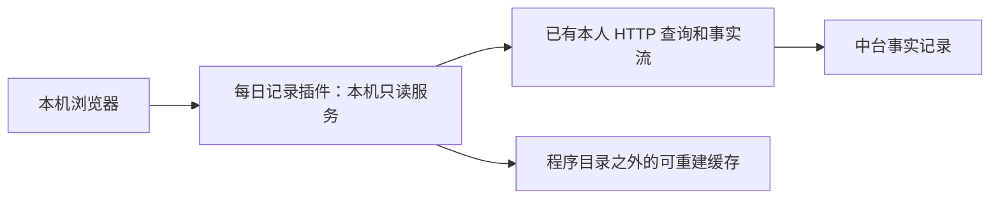

# 每日处理记录插件

用户已选择 sketch/2「结果与依据并读」。本批实现独立只读插件：随应用安装、按需启动、本机浏览器查看；不改内核实现，不新增或改变协议接口。第一期没有 Token、费用或用量展示。

## 使用

```sh
agent-autoloop overview
agent-autoloop overview --port 3360 --no-open
```

第一条命令启动插件并打开浏览器；第二条指定端口且仅打印链接。默认使用随机空闲端口，仅监听 `127.0.0.1`。Ctrl+C 关闭页面服务和订阅，不影响中台。未安装的源码工作区使用 `node bin/agent-autoloop.ts overview`。

代码和页面位于 `plugins/daily-overview/`，随程序安装在 `~/.agent-autoloop/app/plugins/daily-overview/`。客户端命令是 `cli/` 的薄入口，全部读取和展示逻辑留在插件内；不把它伪装成来源或通道，也不增加插件发现类型。独立执行入口是 `node plugins/daily-overview/run.ts`。

配置读取 `AGENT_AUTOLOOP_HOME/config.json`，默认 `~/.agent-autoloop/config.json`，只使用 `url` 和 `owner`。服务端固定向该中台的现有 GET 接口请求，浏览器无法获取本人密钥。插件不导入内核，不读 `hub.db`。



## 页面与计算口径

- 桌面左侧列表、右侧详情并读；窄窗口上下排列，选择后定位到详情，可返回原记录。
- 默认今天，使用当前规则时区；历史日期截止于该日期下一天零点前，详情将后来进展单列。今天每五秒刷新，保留选择、详情展开状态和阅读位置；历史记录同步到已核对范围后停止自动刷新，可手动刷新最新进展。
- “当天有活动”与“截至当日仍待处理”分别成组，可能重叠，不能把两组数量相加。同一次执行跨过午夜也算当天有活动；心跳、在线状态和投递不算业务处理活动。
- 支持规则、执行状态筛选和关键词搜索，列表显示事情、回执结论、状态、累计执行耗时、整个处理历时。每组先显示一百件，再按需显示更多。
- 详情展示触发资料、执行与重试、提问与回答、复查、各次回执摘要，以及来源和会话链接。公开接口没有完整 Agent 输出，页面不冒充完整会话；全文需在原会话查看。
- 执行耗时按各次领取到交回结果的记录相加，包含启动和提交开销，排除排队、重试间隔与等人。正在执行时算到观察时刻；结果待确认或记录时间缺失、倒退时显示无法确认。
- 处理历时从这次处理的触发时间算到没有在跑、排队、重试、待答或待复查时；尚未结束则算到观察时刻。执行结束仅说明一轮结束，不能认定业务已验收。

## 一件业务事情的边界

归并只依据规则、来源、明确对象和回答或复查的关系，不从摘要文字猜对象。

| 情况 | 展示方式 |
| --- | --- |
| 同一规则和来源、同一对象仍在处理期间又来事件 | 同一次处理，多轮归并 |
| 所有执行、排队、重试、待答、复查都结束后的新触发 | 另开一次处理，详情关联同一对象的其他处理 |
| 定时规则再次触发 | 每次触发独立成行，后续回答或复查归回原次 |
| 未配置并行，一轮包含不同对象 | 整批一行，保留共享耗时，不猜各对象分摊 |
| 失败重试把期间排队事件移回原轮 | 合成一件，删除的排队轮不重复计数 |
| 等本人回答或复查但当天无新活动 | 只出现在截至当日待处理组 |

通知未读不自动等于业务仍在执行。没有明确对象的独立外部触发保持分开；可追溯的卡片回答和复查仍归原次。

## 同步与限制

首次从 `/v1/stream?after=0` 读取历史，之后按序号接续。事实按序持久化并去重，序号缺口或不支持的日志版本会停止读取并提示重建。历史查询按事实时间过滤、按序号重放，不因时钟倒退而提前结束扫描。

`/v1/stream` **没有日志末尾或就绪标记**。插件不能用“安静几秒”宣称全部同步完成。启动时另行翻完 `/v1/state` 的所有轮次页，并用每轮 `/why` 取得关联序号，等事实流达到该范围后显示“已核对启动时可见轮次”。这只证明已知轮次的范围，不是全局日志末尾证明。核对前的空列表明确标记不完整；已核对后的空列表仍表述为“尚未发现”。新记录持续接收，断线显示已收到的记录并重连。

缓存位于 `AGENT_AUTOLOOP_HOME/cache/daily-overview/<中台和密钥身份哈希>.sqlite`，默认在 `~/.agent-autoloop` 下。目录权限 0700、文件 0600，不保存本人明文密钥。缓存保存公开接口返回的私有资料，不能分享；退出插件后删除本插件缓存即可完整重读，不删除中台事实。没有版本迁移或写回中台。客户端完整历史保存在本地缓存与内存中，资源随历史增长，不适用内核的常驻内存预算。

## 已覆盖的验证

先写行为测试，再实现：跨天执行、重试间隔、回答续办、复查续办、合批与排队合并、新处理关联、历史状态、夏令时日期边界、异常时间、SSE 分块中文、缓存重启与缺口、HTTP 只读和跨站边界。临时中台通过真实 HTTP 验证完整事实关系，无真实 Agent、业务或通知。

页面使用合成资料验证桌面、窄窗口、长标题、筛选与无结果、历史日期、回执展开、加载和断线状态；还验证无新事实时详情耗时继续增长、展开状态保留，以及历史截止不变时最新进展随新记录更新。生产页面没有演示条目。用户资料按纯文本显示，链接使用允许的协议及会话格式。

本批本地验证：`npm run test:quick` 479 项通过、1 项跳过，`npm run typecheck`、`npm run format:check` 通过。impeccable 独立页面评审及自动更新修复的复评均为 `ship`；设计规范保存在根目录 `DESIGN.md` 与 `.impeccable/design.json`。本记录不表示已发布或更新已安装版本。

## 后续范围

用量与费用、团队或远程访问、回答或停止操作均不在本批范围。

相关资料：[词汇](../CONTEXT.md)、[产品记录](../PRODUCT.md)、[页面简报](daily-overview-surface.md)、[插件边界决定](adr/0001-daily-overview-plugin.md)、[协议](protocol.md)、[安全](../SECURITY.md)。
